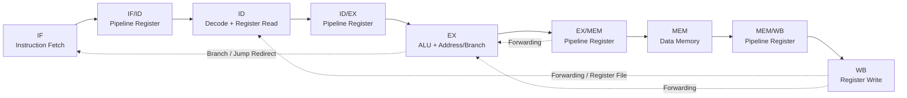

5-Stage Pipelined RISC-V Processor
A 32-bit RISC-V processor implemented in SystemVerilog and simulated using AMD Xilinx Vivado 2022.2.
This project focuses on understanding and implementing the core stages of a pipelined CPU, including instruction execution, pipeline registers, forwarding, hazard handling, memory operations, and branch control.
> **Project status:** Individual directed verification suites have been run successfully. This README reports those individual results; it does not claim exhaustive RV32I compliance.
Overview
A single-cycle processor completes an instruction through its datapath in one long clock cycle. A pipelined processor divides instruction execution into stages so that different instructions can occupy different stages at the same time.
This implementation uses a five-stage pipeline:
Stage	Name	Main responsibility
IF	Instruction Fetch	Fetch the instruction using the current PC and calculate the sequential PC
ID	Instruction Decode	Decode the instruction, read registers, and generate immediate/control information
EX	Execute	Perform ALU operations, calculate effective addresses, and evaluate branch conditions
MEM	Memory Access	Read or write data memory for load/store instructions
WB	Write Back	Select the result and write it into the destination register
Processor pipeline

Instruction flow
The PC supplies the instruction address.
Instruction memory returns the instruction.
The instruction and its PC move through the IF/ID pipeline register.
Decode identifies the operation, source and destination registers, immediate, and control signals.
The execute stage performs the ALU operation, calculates memory addresses, or evaluates branch conditions.
The MEM stage performs data-memory access when required.
The WB stage selects the result and writes it into the register file.
Forwarding paths supply newer values to dependent instructions without waiting for register-file writeback. Hazard control stalls or flushes the pipeline when required.
Pipeline control: forwarding, stalls, and flushes
Data forwarding
A dependent instruction may need a result that has been computed by an earlier instruction but has not yet been written back to the register file.
Forwarding selects a newer result from a pipeline stage and routes it to the ALU input or store-data path. The verification includes ALU-to-ALU dependencies, load-to-ALU forwarding, and load-to-store forwarding.
Load-use hazard
A load obtains its value from data memory. If the next instruction immediately uses that value, the pipeline may need to stall until the loaded data is available. The hazard detection and forwarding behavior was checked using directed tests.
Branch and jump control
When a branch or jump redirects execution, instructions fetched from the wrong path must not update architectural state. Branch verification checks the branch outcomes and the combined test checks that a wrong-path instruction is flushed.
Repository contents
The RTL source files are organized by their function. The exact filenames should match the source files included in the repository.
Typical source modules include:
`top_5_stage_pipeline.sv` — processor top-level module
`prog_cntr.sv` — program counter
`instr_mem.sv` — instruction memory
`data_mem.sv` — data memory
`reg_file.sv` — register file
`alu.sv` — arithmetic and logic unit
`control_unit.sv` — instruction control decoding
Pipeline-register modules — IF/ID, ID/EX, EX/MEM, and MEM/WB
Hazard and forwarding modules — hazard detection and operand forwarding
Verification
Verification was performed using directed SystemVerilog testbenches in Vivado behavioral simulation. Each testbench uses a corresponding instruction-memory hex file where applicable.
Verification suites and results
#	Testbench	Hex program	What it verifies	Result
1	`tb_top_5_stage_branch_verify.sv`	`program_branch.hex`	Branch instruction behavior and branch-related control checks, including the branch conditions represented in the test program	PASS
2	`tb_top_5_stage_load_store_verify.sv`	`program_load_store.hex`	Load/store operation and load-use hazard; checks loaded/stored data and dependent result	PASS
3	`tb_top_5_stage_forwarding_verify.sv`	`program_forwarding.hex`	ALU forwarding for dependent arithmetic instructions	PASS
4	`tb_top_5_stage_load_alu_forwarding.sv`	`program_pipelined.hex`	Load-to-ALU forwarding	PASS
5	`tb_top_5_stage_load_store_edge_cases.sv`	`program_load_store_edge_cases.hex`	Byte, halfword, and word stores/loads; signed and unsigned load behavior; memory byte layout	PASS
6	`tb_top_5_stage_combined.sv`	`program_pipeline_combined.hex`	Combined load-to-store forwarding, load-use with an independent instruction, ALU dependencies, branch flushing, and memory checks	PASS
7	`tb_top_5_stage_reset_x0.sv`	`program_reset_x0.hex`	Reset/restart behavior and protection of register `x0`	PASS
Verified suite count: 7 individual suites passed.
The tests include multiple assertions within each suite. For example, the load/store edge-case suite checks register values and memory bytes, while the combined suite checks several dependency and control-flow scenarios.
Examples of observed passing checks
Load/store + load-use test: `x1 = 42`, `x2 = 42`, `x3 = 43`; memory bytes represent `0x0000002A`.
ALU forwarding test: checked dependent results including `x1 = 10`, `x2 = 15`, `x3 = 18`, `x4 = 7`, `x5 = 9`, `x6 = 16`, and `x7 = 26`.
Load-to-ALU forwarding test: checked `x1 = 42` and `x2 = 47`.
Load/store edge cases: checked signed `LB` sign extension, unsigned `LBU` zero extension, halfword loads, word loads, and little-endian memory bytes. The final simulation printed `PASS: ALL LOAD/STORE EDGE CASES PASSED`.
Combined pipeline test: checked load-to-store forwarding, dependent ALU operations, branch flushing, and memory contents. The simulation printed `PASS: ALL COMBINED PIPELINE TESTS PASSED`.
Reset/x0 test: checked `x0 = 0` and known values in `x1`–`x9`. The simulation printed `PASS: RESET / X0 CHECKS PASSED`.
Verification scope
These are directed simulation tests of the scenarios listed above. They provide evidence for those behaviors, but they are not an exhaustive proof of all RV32I instructions, all possible pipeline interleavings, or full ISA compliance. Additional randomized testing, a broader ISA test suite, and/or formal verification would be needed for stronger compliance claims.
Running simulation in Vivado
Open the project in Vivado 2022.2.
Add the RTL design files under Design Sources.
Add the desired testbench under Simulation Sources.
Add the corresponding `.hex` program file to the simulation project.
In the instruction-memory instance in `top_5_stage_pipeline.sv`, confirm that the `PROGRAM_FILE` parameter points to the correct hex file. Use a path that exists on your machine.
In Simulation Sources, right-click the desired testbench and choose Set as Top.
Run Run Behavioral Simulation.
Inspect the simulation transcript for the testbench's `PASS`/`FAIL` checks.
Run each testbench independently with its corresponding hex program. The hex files are instruction-memory initialization data, not SystemVerilog modules.
Suggested GitHub repository structure
```text
Single-Cycle-RISC-V-Processor/        # Use your actual repository name
├── README.md
├── src/
│   ├── core/
│   │   └── top_5_stage_pipeline.sv
│   ├── modules/
│   │   ├── prog_cntr.sv
│   │   ├── instr_mem.sv
│   │   ├── data_mem.sv
│   │   ├── reg_file.sv
│   │   ├── alu.sv
│   │   └── control_unit.sv
│   ├── pipeline/
│   │   ├── if_id.sv
│   │   ├── id_ex.sv
│   │   ├── ex_mem.sv
│   │   └── mem_wb.sv
│   └── hazards/
│       ├── forwarding_unit.sv
│       └── hazard_detection_unit.sv
├── sim/
│   ├── hex/
│   │   ├── program_branch.hex
│   │   ├── program_forwarding.hex
│   │   ├── program_load_store.hex
│   │   ├── program_load_store_edge_cases.hex
│   │   ├── program_pipeline_combined.hex
│   │   ├── program_pipelined.hex
│   │   └── program_reset_x0.hex
│   └── tb/
│       ├── tb_top_5_stage_branch_verify.sv
│       ├── tb_top_5_stage_combined.sv
│       ├── tb_top_5_stage_forwarding_verify.sv
│       ├── tb_top_5_stage_load_alu_forwarding.sv
│       ├── tb_top_5_stage_load_store_edge_cases.sv
│       ├── tb_top_5_stage_load_store_verify.sv
│       └── tb_top_5_stage_reset_x0.sv
└── docs/
    └── verification/
        └── (simulation screenshots or logs)
```
This is a suggested organization. Preserve your actual module filenames and paths when arranging the files.
Future improvements
Verify any remaining RV32I instructions and corner cases not covered by the directed tests.
Add randomized instruction sequences and scoreboarding.
Run an established RISC-V ISA test suite where supported.
Add synthesis and timing results if the project is later taken through FPGA implementation.
Document known limitations and any unsupported instructions or memory behaviors.
Author
Developed as a learning and hardware-design project using SystemVerilog and Vivado.
